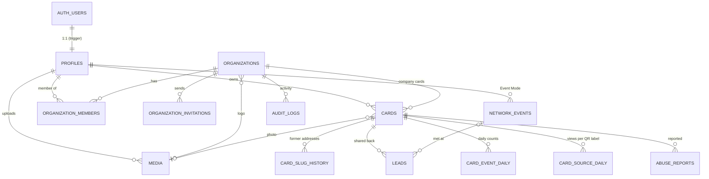

# Mevoriq — Database architecture

Postgres on Supabase. Schema: [`supabase/migrations/20261102120000_mevoriq_schema.sql`](../supabase/migrations/20261102120000_mevoriq_schema.sql).
The app's TypeScript models live in `lib/data/models.ts` and `lib/cards/types.ts`; the Supabase data layer maps rows to those models in `lib/data/supabase/`.

## 1. Principles

| Principle | How it's applied |
|---|---|
| Server is the gatekeeper | The Next.js server uses the Supabase **secret key** and checks every permission in `lib/data/access.ts` before a read or write. The browser never talks to the database directly. |
| Defense in depth | **RLS is enabled on all 15 tables.** Owner-scoped read policies exist for future client use; anonymous visitors have no table access. Moderation, messages and rate limits have no client policies at all. |
| Public data is a projection | Public card pages are built by the server from a whitelisted DTO (`toPublicCard`). Private fields and leads never leave the server. |
| Privacy by design | Analytics store daily counts only. No IP addresses, visitor identifiers or locations are stored anywhere. Rate-limit keys are hashed. |
| Integrity in the database | Check constraints mirror the app's validation (slugs, phone format, URL schemes, template names, lengths), so bad data is rejected even if app code changes. |
| Atomic card edits | Card content (contacts, links, theme) is validated JSON on the card row, written together with an optimistic `version` check. |

## 2. Entity relationships

## 3. Tables

| Table | Purpose | Key columns and rules |
|---|---|---|
| `profiles` | One row per account (created by trigger on `auth.users`) | `display_name`, unique `email` (citext), `avatar_media_id`, `status` |
| `media` | Card photos and organization logos | `kind` avatar/logo, WebP only, ≤ 5 MB, `storage_path` in bucket `card-media` |
| `organizations` | Teams | unique `slug`, `owner_id`, `logo_media_id`, `brand` JSON {template, accent, company, website, lockedFields, adminsCanViewLeads}, `status` |
| `organization_members` | Membership and role | PK (org, user); `role` owner/admin/manager/member; `status` active/deactivated; one owner per org |
| `organization_invitations` | Invite links | `token_hash` (sha256, raw token never stored), `expires_at` (7 days), single use (`accepted_at`), `revoked_at` |
| `reserved_slugs` | Addresses nobody can claim | `admin`, `app`, `api`, `login`, … (trigger rejects them on cards) |
| `cards` | Personal and company cards | unique `slug` (citext, 3–40, kebab-case), `organization_id` null = personal, `contacts`/`links`/`theme` JSON with shape checks, `status` draft/published/archived/suspended, `version` |
| `card_slug_history` | Old addresses → card | lets printed QR codes keep working after an address change |
| `leads` | Contacts shared back by visitors | consent version + time, separate `marketing_consent`, `status`, `tags` (≤10), private `note`, `follow_up_at`, `event_id` (the owner's live event when it arrived) |
| `card_source_daily` | Views per labelled QR (print, badge, signature, slides, social) per card per day | counts only; written by `record_card_source` (server only); keys match `lib/cards/sources.ts` |
| `network_events` | Event Mode: a person's conference/meetup session | `name`, `tag` (added to every lead met there), `started_at`, `ended_at`; one open event per person (partial unique index); an open event stops tagging after 18 hours (`lib/events.ts`); deleting it keeps the leads (`event_id` set null) |
| `card_event_daily` | Analytics | PK (card, date, type); types view, unique_view, save_contact, link_click, qr_download, exchange |
| `abuse_reports` | Moderation queue | `reason`, `state` open/actioned/dismissed, `resolved_by` |
| `contact_messages` | Contact form | `topic`, `state` new/done |
| `audit_logs` | Security-relevant actions | `actor_id`, `organization_id`, `action`, redacted `metadata` |
| `feature_flags` | Runtime switches | contact_exchange, teams, signups, maintenance_mode |
| `rate_limits` | Shared limiter for serverless | fixed window per hashed key |

## 4. Functions and triggers

| Name | Kind | What it does |
|---|---|---|
| `handle_new_user` | trigger on `auth.users` insert | creates the profile (name from sign-up metadata, Google name, or email) |
| `handle_user_email_change` | trigger on `auth.users` update | keeps `profiles.email` in sync |
| `set_updated_at` | trigger | maintains `updated_at` |
| `reject_reserved_slug` | trigger on `cards` | blocks reserved addresses |
| `record_card_event(card, type)` | function, server only | atomic daily counter upsert |
| `hit_rate_limit(key, limit, window)` | function, server only | returns false when the limit is exceeded |
| `cleanup_expired()` | function, server only | removes stale rate-limit rows and long-expired invitations (schedule daily with Supabase Cron) |
| `org_role(org)` | helper for RLS | the signed-in user's active role in an organization |

## 5. Who can do what (enforced in `lib/data/access.ts`)

| Action | Visitor | Card owner | Team member | Team manager | Team admin / owner | Platform admin |
|---|---|---|---|---|---|---|
| View a published card, save contact | ✓ | ✓ | ✓ | ✓ | ✓ | ✓ |
| Share details back, report a card | ✓ | ✓ | ✓ | ✓ | ✓ | ✓ |
| Edit own personal card | – | ✓ | – | – | – | – |
| Edit own company card (unlocked fields) | – | – | ✓ | ✓ | ✓ | – |
| Create company cards | – | – | – | ✓ | ✓ | – |
| Invite, change roles, remove access, set brand | – | – | – | – | ✓ | – |
| See contacts from own cards | – | ✓ | ✓ | ✓ | ✓ | – |
| See contacts from company cards | – | – | – | – | if org enabled | – |
| Moderation, flags, messages, audit | – | – | – | – | – | ✓ |

## 6. Storage

Bucket **`card-media`**: public read (photos appear on public cards), WebP only, 5 MB limit. Objects are written and deleted only by the server after it validates the file signature and re-encodes the image (`lib/data/media.ts`). Paths: `{owner_user_id}/{media_id}.webp`.

## 7. Data lifecycle

| Event | Effect |
|---|---|
| Account deleted | `auth.users` row deleted → cascades to profile, cards, slug history, leads, events, media rows, memberships; app removes storage objects |
| Card deleted | cascades to slug history, leads, events, reports |
| Member removed from a team | membership `deactivated`, their company cards unpublished; personal cards untouched |
| Invitation | expires after 7 days; cleaned up 30 days after expiry |
| Rate-limit rows | removed daily |

## 8. Setting up a new Supabase project

1. Supabase dashboard → **SQL Editor** → paste and run each file in `supabase/migrations/` in name order (`20261102120000_mevoriq_schema.sql`, then `20261102130000_event_mode.sql`, then `20261102140000_qr_sources.sql`), or `supabase db push` with the CLI.
2. **Authentication → Providers**: enable *Email* (magic link) and *Google* (add the Google OAuth client ID/secret).
3. **Authentication → URL Configuration**: Site URL = your production URL; add redirect URLs `https://YOUR_DOMAIN/auth/callback` and `http://localhost:3001/auth/callback`.
4. **Project Settings → API keys**: copy the project URL, the publishable key and the secret key into the environment (see `.env.example`). The secret key must only ever be set on the server (Vercel env vars), never exposed to the browser.
5. Optional: **Integrations → Cron**: schedule `select public.cleanup_expired();` daily.

## 9. Verification

The migration is exercised on a real Postgres engine (PGlite) with Supabase-style `auth`/`storage` stubs: profile-on-signup trigger, reserved-slug rejection, phone/theme/slug constraints, case-insensitive unique slugs, the analytics counter, the rate limiter, and RLS enabled on every table.
